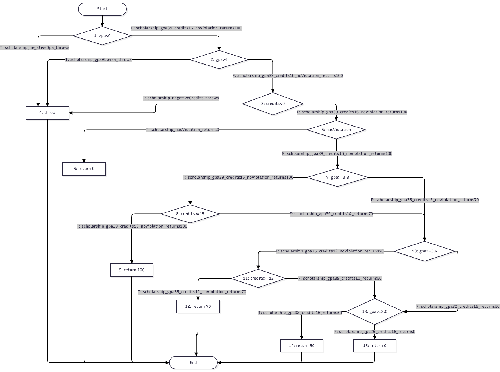

# Лаб 9 — Код хамралт — JaCoCo-гоор тестээ хөтлөх

- **Оюутны нэр:** Б. Намуундарь
- **Оюутны код:** B232270037

## Орчин

OpenJDK 17.0.17, Maven 3.9.12, JUnit 5.10.2, JaCoCo 0.8.12 (macOS).

## Хэсэг A: Happy path тестүүд ба эхний хэмжилт

Зөвхөн хэвийн урсгалын 5 тест бичсэн (`Tests run: 5`, бүгд ногоон).
Гаралт: [results/mvn-verify-A.txt](results/mvn-verify-A.txt), [results/jacoco-A.csv](results/jacoco-A.csv).

| Хэмжүүр | Covered | Missed | Хамралт |
|---|---|---|---|
| Line | 15 | 10 | 15/25 = **60.0%** |
| Branch | 20 | 21 | 20/41 ≈ **48.8%** |

Шар ромботой мөрүүд нь оролтын шалгалтын `||` нөхцөлүүд (20, 31, 48-р мөр — зөвхөн "бүгд худал" талаараа явсан), `gpa`-ийн `switch` (36 — 5 салаанаас зөвхөн A, B), мөн `scholarship`-ийн `hasViolation` ба `&&` нөхцөлүүд (51–53 — зөрчилтэй болон "голч хангасан ч кредит дутуу" тохиолдол туршигдаагүй).
Улаан мөрүүд нь гурван `throw new IllegalArgumentException` (21, 32, 49) буюу буруу оролтын алдааны замууд юм.
Үүнээс гадна F дүн буцаах (27), `gpa`-ийн C, D case (39, 40), тэтгэлэггүй `return 0` (55) мөрүүд огт ажиллаагүй.

## Хэсэг B: CFG ба branch 100%

### `scholarship()` функцын CFG

| Ирмэг | Дайрч буй тест | Хэсэг |
|---|---|---|
| 1 –T→ 4 | `scholarship_negativeGpa_throws` | B (шинэ) |
| 2 –T→ 4 | `scholarship_gpaAbove4_throws` | B (шинэ) |
| 3 –T→ 4 | `scholarship_negativeCredits_throws` | B (шинэ) |
| 1 –F→ 2 –F→ 3 –F→ 5 | `scholarship_gpa39_credits16_noViolation_returns100` | A |
| 5 –T→ 6 | `scholarship_hasViolation_returns0` | B (шинэ) |
| 5 –F→ 7 –T→ 8 –T→ 9 | `scholarship_gpa39_credits16_noViolation_returns100` | A |
| 8 –F→ 10 | `scholarship_gpa39_credits14_returns70` | B (шинэ) |
| 7 –F→ 10 –T→ 11 –T→ 12 | `scholarship_gpa35_credits12_noViolation_returns70` | A |
| 11 –F→ 13 | `scholarship_gpa35_credits10_returns50` | B (шинэ) |
| 10 –F→ 13 –T→ 14 | `scholarship_gpa32_credits16_returns50` | B (шинэ) |
| 13 –F→ 15 | `scholarship_gpa25_credits16_returns0` | B (шинэ) |

### Нэмсэн тестүүд ба үр дүн

Хэсэг A-гийн 5 тест дээр **16 тест нэмж**, нийт **21 тест** болсон (`Tests run: 21, Failures: 0`):

- `letterGrade` — 5 шинэ: сөрөг оноо, 100-аас их оноо (`assertThrows`), C, D, F дүн.
- `gpa` — 3 шинэ: `null`, хоосон массив (`assertThrows`), таван дүн бүгдийг агуулсан массив (C, D case ба `default` салаа).
- `scholarship` — 8 шинэ: `||` нөхцөл тус бүрд нэг `assertThrows` (3), зөрчилтэй, голч хангасан ч кредит дутуу хоёр тохиолдол, 50%, 0%.

Гаралт: [results/mvn-verify-B.txt](results/mvn-verify-B.txt), [results/jacoco-B.csv](results/jacoco-B.csv).

| Хэмжүүр | Covered | Missed | Хамралт |
|---|---|---|---|
| Line | 25 | 0 | 25/25 = **100%** |
| Branch | 41 | 0 | 41/41 = **100%** |
